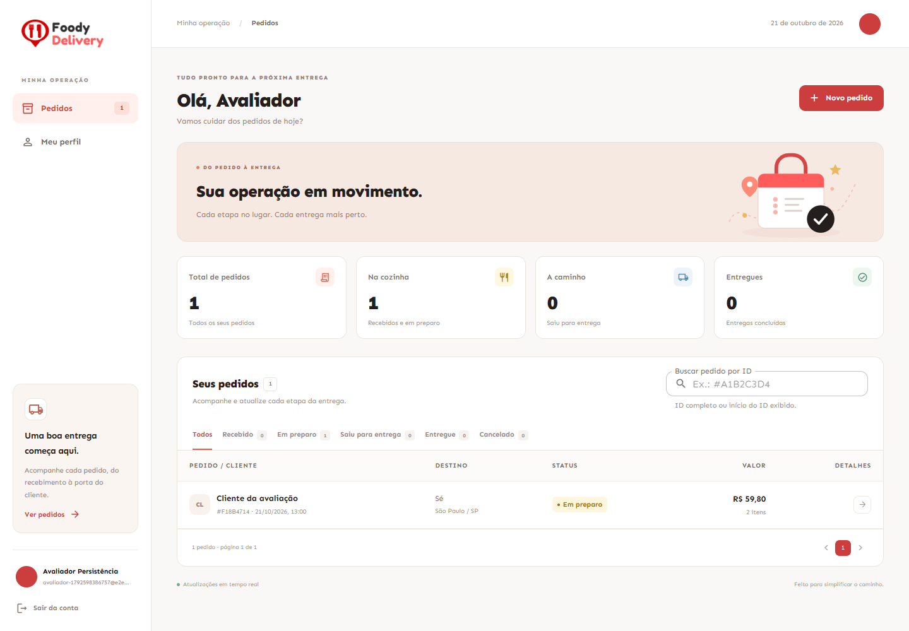
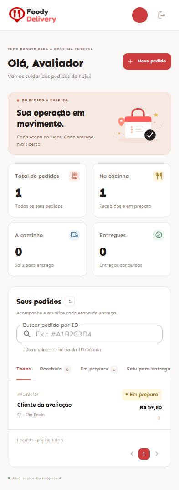

# Validação como avaliador — clone público

Validação realizada em 21/10/2026 a partir de um clone novo da branch `main`, revisão `16b6da091b91fd5f7eb3c59f2eb045290983c4fa`. O clone foi obtido por HTTPS sem credenciais do GitHub. Nenhum arquivo versionado do clone foi alterado para executar a aplicação.

Ambiente: Windows, JDK 21.0.12.1, Maven 3.9.11 e Node.js 24.15.0. O caminho validado foi a execução local com H2, descrita no README.

## Passo a passo executado

### 1. Clonar o repositório público

```sh
git clone https://github.com/CleissonV/foody-tracker.git
cd foody-tracker
```

Resultado: clone concluído sem autenticação, histórico disponível e branch padrão `main`.

### 2. Iniciar a API

Com JDK 21 instalado e `JAVA_HOME` configurado, em um terminal PowerShell:

```powershell
cd backend
.\mvnw.cmd spring-boot:run
```

Resultado: API na porta 8080; Flyway criou as duas migrações H2 em um banco vazio, sem importar dados de outro projeto. O arquivo foi criado em `backend/data/foody.mv.db`.

- `GET /actuator/health`: `200`, com `{"status":"UP"}`.
- Swagger em `http://127.0.0.1:8080/swagger-ui.html`: `200`.
- `GET /api/orders` sem sessão: `401`.

### 3. Iniciar o front-end

Em outro terminal, a partir da raiz do repositório:

```sh
cd frontend
npm ci
npm run dev
```

Resultado: instalação concluída pelo lockfile e interface disponível em `http://127.0.0.1:5173`. O proxy encaminhou as chamadas à API sem configuração adicional do projeto.

### 4. Percorrer os fluxos pela interface

1. Cadastrar uma conta nova e entrar no painel vazio.
2. Criar um pedido com duas unidades de R$ 29,90; total calculado de R$ 59,80.
3. Digitar o CEP 01001-000 e conferir o preenchimento real pelo ViaCEP: Praça da Sé, Sé, São Paulo/SP; informar o número manualmente.
4. Avançar o pedido de `RECEBIDO` para `EM_PREPARO`.
5. Buscar pelo início do ID, em maiúsculas e com `#`, e limpar a busca.
6. Atualizar o nome do perfil e enviar uma foto PNG.

Todos esses passos funcionaram. Não foram observadas exceções JavaScript durante o percurso. Os fluxos adicionais de entrega, cancelamento, troca de credenciais, revogação, sincronização entre sessões e recuperação de conexão foram cobertos pela suíte E2E.

### 5. Conferir persistência após reiniciar

Foi encerrado e iniciado novamente o processo da API, mantendo o arquivo H2. A sessão anterior retornou `401`, conforme o armazenamento local em memória descrito no README. Após novo login:

- O pedido manteve o mesmo UUID, status `EM_PREPARO` e total de R$ 59,80.
- O nome atualizado do perfil foi preservado.
- A foto retornou `200` e manteve o mesmo hash SHA-256 e tamanho de 855 bytes.

### 6. Executar os dados de demonstração opcionais

Com a API em execução, na raiz:

```sh
node scripts/seed-demo.mjs
```

Resultado: oito pedidos fictícios criados na conta local de demonstração indicada no README. A segunda execução detectou os pedidos existentes e não duplicou dados.

### 7. Executar testes e build

Na pasta `backend`, o ciclo Maven `clean verify` aprovou 58 testes e gerou JAR e relatório JaCoCo.

Na pasta `frontend`:

```sh
npm run lint
npm run format:check
npm test
npm run build
npx playwright install chromium
npm run test:e2e
```

O navegador da execução E2E foi o Chrome instalado, configurado por `PLAYWRIGHT_EXECUTABLE_PATH`, opção prevista no README. Os cenários usaram sua própria API em memória na porta 8081 e front-end na porta 5174.

## Resultados

| Verificação | Resultado |
| --- | --- |
| Clone público | Aprovado sem credenciais |
| API e migrações em banco novo | Aprovado |
| Front-end pelo comando do README | Aprovado |
| Testes Java | 58 aprovados; zero falhas, erros ou testes ignorados |
| Testes de front-end | 30 aprovados em nove arquivos |
| ESLint | Aprovado, zero warnings do código |
| Prettier | Aprovado |
| Build TypeScript/Vite | Aprovado |
| E2E | 12 aprovados: seis desktop e seis mobile; zero falhas, flaky ou testes ignorados |
| ViaCEP real | Preenchimento conferido pela interface |
| Persistência H2 | Pedido, status, total, nome e foto preservados após reinício |
| Dados de demonstração | Oito pedidos; repetição sem duplicação |
| Layout | Desktop e viewport móvel de 393 px; sem overflow horizontal da página |
| `npm audit --omit=dev` | Zero vulnerabilidades reportadas nas dependências de execução |
| `docker compose config --quiet` | Aprovado |
| Build e execução Docker locais | Não executados: engine Docker indisponível |

## Limites do ambiente de validação

O executor Windows restrito impediu o download inicial do Maven pelo PowerShell e o carregamento dinâmico do agente Mockito. A distribuição oficial do Maven foi obtida com o checksum SHA-256 especificado no wrapper, e os testes Java passaram em outro processo local com o mesmo JDK e Maven. O download de dependências usou um encaminhamento local para o repositório oficial por causa das restrições de rede do executor; os caches de dependências foram criados para esta avaliação.

A instalação do Chromium terminou, mas o executor não preservou seu diretório de perfil entre sessões. Por isso a suíte final utilizou o Chrome instalado por meio da configuração documentada, sem alterar os testes ou a aplicação.

O `npm ci` também reportou três vulnerabilidades em dependências de desenvolvimento, uma moderada e duas críticas. A consulta separada com `--omit=dev` retornou zero. Não foram feitas atualizações automáticas de dependências nesta avaliação.

A validação cobre a variante H2 da branch padrão. A publicação PostgreSQL tem [registro separado](https://github.com/CleissonV/foody-tracker/blob/deploy/vercel-postgres/docs/production.md).

## Evidências visuais

Desktop, após reinício e novo login:



Viewport móvel:


