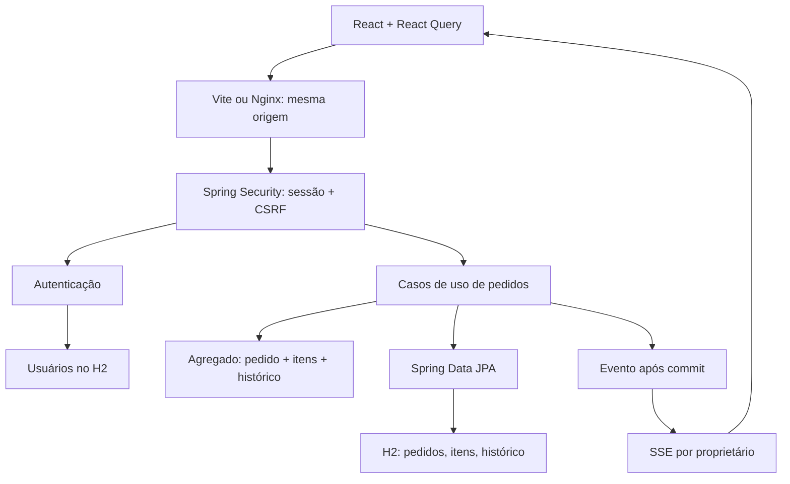
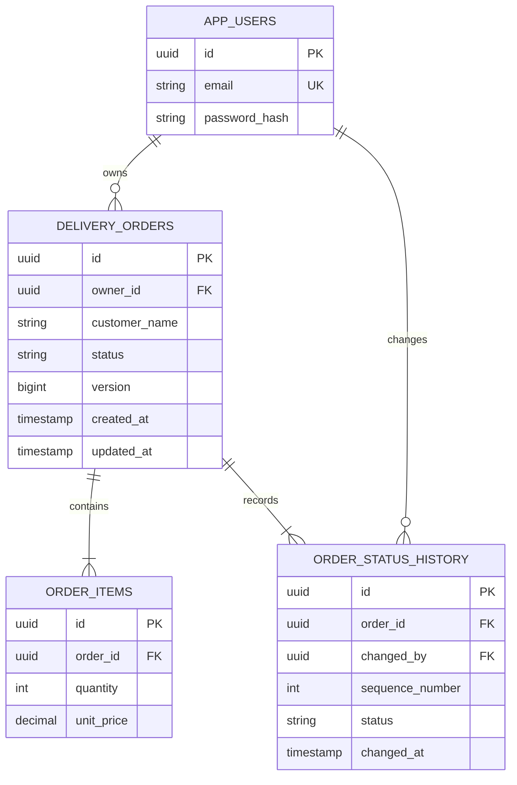
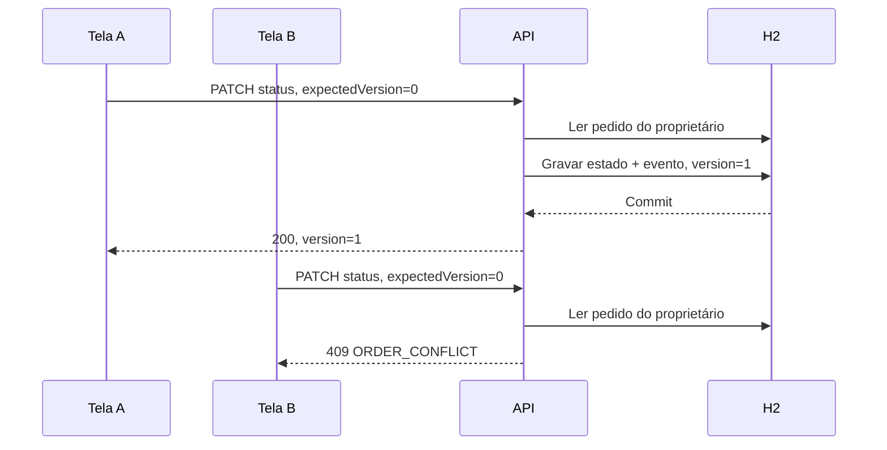
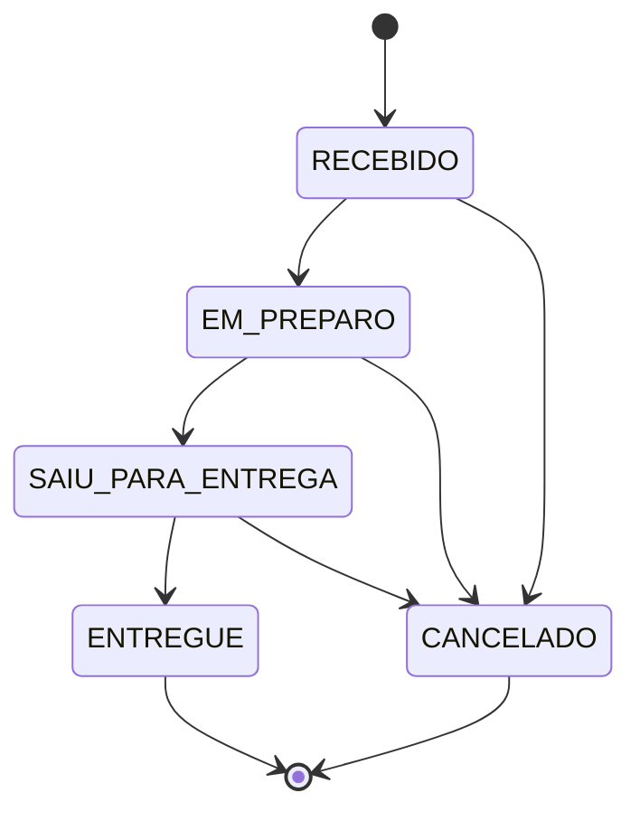

# System design

## Objetivo e fronteira

Receber pedidos, consultar suas etapas e registrar mudanças de status com autenticação. Uma conta representa uma operação isolada. O navegador consulta o ViaCEP para auxiliar o preenchimento do endereço. Não há rastreamento de localização ou mensageria externa em execução.

## Arquitetura implementada

Os dois nós H2 representam tabelas no mesmo banco. O monólito tem um processo, um banco e uma unidade de implantação. O Nginx serve arquivos estáticos e encaminha chamadas HTTP. A API inicia vinculada ao loopback por padrão; no Compose, a porta é publicada apenas em `127.0.0.1`.

## Modelo de dados

O endereço é um snapshot embutido no pedido. Alterar um endereço futuro não muda uma entrega passada. O valor total é derivado dos itens, evitando duas fontes persistidas para o mesmo valor. Valores monetários usam `NUMERIC`/`BigDecimal`. Datas são instantes UTC; a interface usa o fuso do navegador.

O módulo `profile` administra dados pessoais, credenciais e foto. `app_users` recebeu `version` (concorrência), `credentials_version` (revogação de sessões), `avatar_version` e `avatar_data` (BLOB). O perfil usa controle otimista para evitar sobrescrever uma edição antiga; fotos são redimensionadas para 256×256 antes de persistir, mantendo o BLOB pequeno. Em maior escala, a imagem poderia ir para storage privado com URL autorizada; isso não é necessário no ambiente embarcado.

Índices cobrem proprietário + criação, proprietário + status e associações de itens/histórico. A paginação ordena por `createdAt DESC, id DESC`, evitando ordem ambígua para instantes iguais. A busca por prefixo de ID normaliza UUIDs na consulta e combina proprietário/status antes de paginar. Esse cast/replace é simples no H2 do exercício, mas não aproveita um índice convencional de UUID para prefixos; em maior volume, medir e criar uma coluna/índice adequado ou separar a busca exata por UUID. Offset pagination é suficiente ao tamanho do exercício; novas inserções podem deslocar páginas. Grandes volumes exigiriam cursor composto e ajuste de índices pelo plano real da consulta.

## Consistência e concorrência

O serviço compara a versão informada com a persistida, prevenindo escritas iniciadas por uma tela antiga. `@Version` também protege a janela entre leitura e gravação por duas transações simultâneas. A alteração do pedido e o evento de histórico estão na mesma transação: ambos confirmam ou ambos sofrem rollback. A restrição de sequência única do histórico também pode rejeitar a segunda escrita concorrente; a API a apresenta como conflito de dados (`409`).

Ao receber `409`, a interface busca o pedido atual, exibe o conflito e exige nova ação do usuário. Escritas não são repetidas automaticamente. A criação ainda não possui chave de idempotência: um cliente externo pode duplicar pedidos em um retry após perder a resposta. A UI desabilita o envio durante a requisição, mas isso não substitui idempotência no servidor.

O histórico é de alterações do pedido, não um sistema de event sourcing ou um log de auditoria imutável protegido contra administradores do banco.

## Máquina de estados

`OrderStatus` é a fonte das transições permitidas. A API retorna `allowedNextStatuses`; a interface mostra as ações que recebeu, sem reproduzir a regra de negócio.

## Segurança

- Senhas com BCrypt, custo 12. O limite de 72 bytes UTF-8 é validado antes do hash.
- Autenticação pela infraestrutura do Spring Security; mensagens de credenciais inválidas não distinguem usuário desconhecido de senha incorreta.
- A sessão é persistida explicitamente no `SecurityContextRepository`; o identificador muda no login. Expiração após 30 minutos de inatividade HTTP. Reconexões periódicas do SSE contam como atividade; uma aba aberta pode manter a sessão.
- Cookie HttpOnly, SameSite=Lax, transporte apenas por cookie; em HTTPS, `COOKIE_SECURE=true`. Não há token de autenticação no `localStorage`.
- Token CSRF obtido por endpoint, guardado em memória e enviado no header em toda escrita, inclusive cadastro e login. Login e logout exigem renovação do token.
- Cada busca/alteração inclui o proprietário autenticado. IDs de terceiros retornam `404`, reduzindo enumeração e prevenindo IDOR.
- Erros usam `application/problem+json` e não devolvem stack trace ou hash de senha. O console H2 permanece desativado. Swagger pode ser bloqueado por configuração.
- Nginx adiciona CSP e headers de segurança. Os assets da interface são locais, sem carregamento de analytics ou scripts do site de referência.
- A troca de e-mail e senha exige a senha atual. Cada requisição autenticada consulta a versão de credenciais em uma projeção escalar do banco; sessões antigas são invalidadas após uma troca. A sessão que confirmou a operação é renovada com o principal atualizado. Isso acrescenta uma consulta por requisição autenticada; em uma implantação distribuída, a decisão de cache/revogação precisa respeitar a janela de segurança desejada.
- O upload de foto verifica conteúdo PNG/JPEG, tamanho e dimensões antes da decodificação completa; recorta e reencoda a imagem, eliminando os metadados fornecidos. SVGs e arquivos disfarçados são rejeitados. A foto é privada à conta e herda a proteção da sessão.

Limitação: autenticação pública não tem rate limit. Antes de exposição pública, adicionar limite de tentativas por IP/conta, respostas adequadas a abuso e TLS no gateway. A ausência é deliberadamente declarada, não coberta pelo rótulo de “acesso seguro”.

## Leitura e atualização da interface

React Query administra cache e invalidação por eventos SSE. A listagem retorna um resumo; itens e histórico completos só aparecem no detalhe. `default_batch_fetch_size=50` agrupa a carga de itens necessária para os totais, evitando uma consulta por pedido. Um teste garante no máximo três statements para uma página de oito pedidos. O teste não é um benchmark nem prova um limite universal para qualquer página.

O navegador mantém um `EventSource` autenticado em `GET /api/orders/events`. Depois do commit de criação ou mudança de status, o servidor envia `orders-changed` apenas às conexões do proprietário. A mensagem contém o ID, não uma cópia do agregado. O cliente invalida lista, indicadores e detalhes ativos e busca o estado autorizado por REST. Uma escrita revertida não publica aviso.

O evento `ready` dispara nova leitura ao conectar/reconectar, cobrindo alterações perdidas antes da inscrição ou enquanto offline. Não há replay, offset durável ou promessa de entrega de cada evento; o objetivo é convergir para o estado atual. Heartbeats de 15 s detectam desconexões e verificam sessão/versão de credenciais; essa checagem também ocorre antes de cada aviso. A conexão tem duração máxima de cinco minutos e o navegador a refaz automaticamente. Logout ou revogação fecham o canal. Durante falhas, a interface informa reconexão e consulta os dados a cada 10 s até recuperar o SSE. Conectada, não faz polling periódico de pedidos.

O registro de conexões é concorrente, em memória, limitado a 8 por conta e 200 por processo; callbacks removem conexões encerradas. O Nginx encaminha o stream sem buffering/cache. Isso atende uma instância. Antes de ampliar réplicas ou clientes, medir custo dos heartbeats, latência e clientes lentos, e introduzir distribuição de eventos e isolamento do envio por cliente. O envio atual é síncrono e não representa uma solução para grande fan-out.

Sessão expirada limpa o cache e retorna ao login. Mutations continuam invalidando as consultas imediatamente na própria tela. Os eventos sincronizam outras abas e sessões da mesma conta.

## Evolução para maior volume — proposta, não implementada

1. **Medir primeiro:** latência p50/p95/p99, erros, taxa de pedidos, consultas lentas, consumo de conexões e conflitos. Health check já existe; métricas de negócio, tracing e dashboards ainda não.
2. **Banco externo:** PostgreSQL/Cloud SQL, backups, pool limitado e migrações validadas contra esse banco. A migração atual foi executada no H2; não se afirma portabilidade automática.
3. **Escalar instâncias:** serviço Java em containers, sessões em Redis via Spring Session e balanceamento. H2 em arquivo não deve ser compartilhado por réplicas.
4. **Distribuir atualizações:** manter SSE para servidor → navegador, distribuir invalidações entre instâncias e isolar clientes lentos. WebSocket se houver necessidade bidirecional, por exemplo localização de entregador.
5. **Notificações confiáveis:** gravar um outbox na mesma transação do status; um worker publica e reprocessa com entrega pelo menos uma vez e deduplicação. Um evento disparado antes do commit pode anunciar um estado que será revertido.
6. **Integrações:** adaptadores para marketplaces/pagamentos, timeouts, circuit breaker, retries limitados, idempotência e fila de falhas. Webhooks precisam de verificação de autenticidade e proteção contra replay.
7. **Multioperador:** separar `workspace/organization` de usuário e introduzir associação e papéis, em vez de simplesmente remover o filtro `ownerId`.

Um caminho possível na GCP seria Cloud Run para a API, Cloud SQL para PostgreSQL, Secret Manager para credenciais e Cloud Tasks/Pub/Sub para trabalhos assíncronos. Não foram provisionados recursos GCP. Kubernetes e microserviços não são pré-requisitos para este domínio ou este volume ainda não medido.
